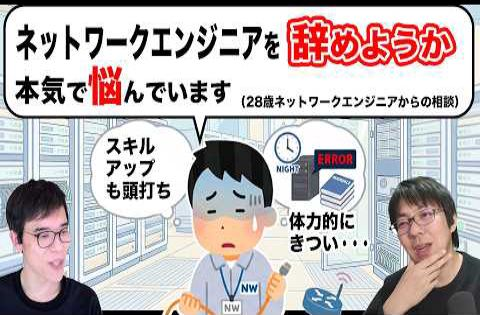

# show int レポート

## 動画名

1. [責任の重いチームリーダーの役割になったときに家族の存在に助けられた話](https://www.youtube.com/watch?v=jMaE0dvmmjY)  
 ( 2026-05-04 公開)

1. [ネットワークエンジニアを辞めようと思ったことある？【人生相談】](https://www.youtube.com/watch?v=QkMnhxv5yY8)  
 ( 2026-05-11 公開)

1. [生成AI向けデータセンター 、普通のDCと何が違うの？](https://www.youtube.com/watch?v=nebaHUZSPUA)  
 ( 2026-05-18 公開)

1. [総額10万円以上の自宅10Gbpsネットワークを数ヶ月使ってみた感想](https://www.youtube.com/watch?v=vAKmvVeUAn8)  
 ( 2026-05-26 公開)

1. [実力のあるネットワークエンジニアは、なぜ転職しないのか](https://www.youtube.com/watch?v=DXywOKGX5aU)  
 ( 2026-06-01 公開)

1. [『理想のエンジニア』を採用するには、何をするべきか。何をやってはいけないか。](https://www.youtube.com/watch?v=P4JHBQlGK4M)  
 ( 2026-06-08 公開)

1. [現役ネットワークエンジニアが『インターネットの絵本』を作りたくなった話](https://www.youtube.com/watch?v=xqTUhtzpGV4)  
 ( 2026-06-15 公開)

1. [現役エンジニアが実践する在宅ワーク中の効率の良い『休憩時間』の過ごし方](https://www.youtube.com/watch?v=G1latybZrEE)  
 ( 2026-06-22 公開)

1. [変化の激しいAIデータセンター最新技術のキャッチアップに苦労している話](https://www.youtube.com/watch?v=TBEpi0Vp5t4)  
 ( 2026-06-29 公開)

1. [コンテンツ充実しすぎ!? JANOG58 in 愛媛 松山 の発表タイムテーブルを眺めてみよう【開催直前!! JANOG58 松山 7/15(水)~17(金)】](https://www.youtube.com/watch?v=ruLrwkFUHtc)  
 ( 2026-07-06 公開)

<!-- pagebreak -->

|項目|内容|
|---|---|
|動画名|責任の重いチームリーダーの役割になったときに家族の存在に助けられた話|
|動画URL|https://www.youtube.com/watch?v=jMaE0dvmmjY|
|動画公開日|2026-05-04|
|集計期間|2026-05-04 ~ 2026-09-25 ( 144 日間 ) |
|サムネイル||
|再生回数|238 回|
|グッド回数|4|
|バッド回数|1|
|インプレッション数|23 回|
|インプレッションからのクリック率|-1.00 %|
|視聴者の年齢と性別| 男性: 100 %  女性: 0% 13～17 歳 0%        25～34 歳 52.3% 18～24 歳 0%        35～44 歳 47.7% 45～54 歳 0%        55～64 歳 0%        65 歳以上 0% |
|トラフィック流入元|show int 登録者へのおすすめ : 59.2%   show int チャンネルページ : 15.9% YouTube関連動画 : 3.3%    YouTube検索 : 2.9%   外部サイトからの流入 : 2.9%|
|外部サイトからの流入の内訳|twitter.com : 85.7% Creator Studio : 14.2%|

<!-- pagebreak -->

<!-- pagebreak -->

|項目|内容|
|---|---|
|動画名|ネットワークエンジニアを辞めようと思ったことある？【人生相談】|
|動画URL|https://www.youtube.com/watch?v=QkMnhxv5yY8|
|動画公開日|2026-05-11|
|集計期間|2026-05-11 ~ 2026-09-25 ( 137 日間 ) |
|サムネイル||
|再生回数|2031 回|
|グッド回数|32|
|バッド回数|2|
|インプレッション数|128 回|
|インプレッションからのクリック率|10.00 %|
|視聴者の年齢と性別| 男性: 100 %  女性: 0% 13～17 歳 0%        25～34 歳 64.3% 18～24 歳 9.4%        35～44 歳 20.5% 45～54 歳 5.8%        55～64 歳 0%        65 歳以上 0% |
|トラフィック流入元|show int 登録者へのおすすめ : 61.3%   show int チャンネルページ : 6.2% YouTube関連動画 : 5.8%    YouTube検索 : 6.5%   外部サイトからの流入 : 12.4%|
|外部サイトからの流入の内訳|twitter.com : 96% Google Search : 1.1% Chrome : 0.3% Creator Studio : 0.3% discord.com : 0.3% office.net : 0.3%|

<!-- pagebreak -->

<!-- pagebreak -->

|項目|内容|
|---|---|
|動画名|生成AI向けデータセンター 、普通のDCと何が違うの？|
|動画URL|https://www.youtube.com/watch?v=nebaHUZSPUA|
|動画公開日|2026-05-18|
|集計期間|2026-05-18 ~ 2026-09-25 ( 130 日間 ) |
|サムネイル||
|再生回数|777 回|
|グッド回数|34|
|バッド回数|1|
|インプレッション数|107 回|
|インプレッションからのクリック率|5.00 %|
|視聴者の年齢と性別| 男性: 100 %  女性: 0% 13～17 歳 0%        25～34 歳 44.9% 18～24 歳 0%        35～44 歳 55.1% 45～54 歳 0%        55～64 歳 0%        65 歳以上 0% |
|トラフィック流入元|show int 登録者へのおすすめ : 52.6%   show int チャンネルページ : 10.2% YouTube関連動画 : 13.3%    YouTube検索 : 7.8%   外部サイトからの流入 : 3.9%|
|外部サイトからの流入の内訳|twitter.com : 70.9% Google Search : 9.6% Chrome : 3.2% bing.com : 3.2%|

<!-- pagebreak -->

<!-- pagebreak -->

|項目|内容|
|---|---|
|動画名|総額10万円以上の自宅10Gbpsネットワークを数ヶ月使ってみた感想|
|動画URL|https://www.youtube.com/watch?v=vAKmvVeUAn8|
|動画公開日|2026-05-26|
|集計期間|2026-05-26 ~ 2026-09-25 ( 122 日間 ) |
|サムネイル||
|再生回数|2159 回|
|グッド回数|33|
|バッド回数|2|
|インプレッション数|150 回|
|インプレッションからのクリック率|10.00 %|
|視聴者の年齢と性別| 男性: 100 %  女性: 0% 13～17 歳 0%        25～34 歳 50.7% 18～24 歳 9%        35～44 歳 29.2% 45～54 歳 11.1%        55～64 歳 0%        65 歳以上 0% |
|トラフィック流入元|show int 登録者へのおすすめ : 69.4%   show int チャンネルページ : 4.9% YouTube関連動画 : 10.9%    YouTube検索 : 2%   外部サイトからの流入 : 5.2%|
|外部サイトからの流入の内訳|twitter.com : 84.9% Google Search : 3.5% Creator Studio : 0.8% Discord : 0.8% jp.co.yahoo.android.yjtop : 0.8% m : 0.8%|

<!-- pagebreak -->

<!-- pagebreak -->

|項目|内容|
|---|---|
|動画名|実力のあるネットワークエンジニアは、なぜ転職しないのか|
|動画URL|https://www.youtube.com/watch?v=DXywOKGX5aU|
|動画公開日|2026-06-01|
|集計期間|2026-06-01 ~ 2026-09-25 ( 116 日間 ) |
|サムネイル||
|再生回数|1020 回|
|グッド回数|19|
|バッド回数|0|
|インプレッション数|107 回|
|インプレッションからのクリック率|2.00 %|
|視聴者の年齢と性別| 男性: 100 %  女性: 0% 13～17 歳 0%        25～34 歳 49.2% 18～24 歳 0%        35～44 歳 39% 45～54 歳 11.8%        55～64 歳 0%        65 歳以上 0% |
|トラフィック流入元|show int 登録者へのおすすめ : 47.2%   show int チャンネルページ : 9.9% YouTube関連動画 : 19.2%    YouTube検索 : 14.4%   外部サイトからの流入 : 1.9%|
|外部サイトからの流入の内訳|twitter.com : 85% Google Search : 5% cybozu.com : 5%|

<!-- pagebreak -->

<!-- pagebreak -->

|項目|内容|
|---|---|
|動画名|『理想のエンジニア』を採用するには、何をするべきか。何をやってはいけないか。|
|動画URL|https://www.youtube.com/watch?v=P4JHBQlGK4M|
|動画公開日|2026-06-08|
|集計期間|2026-06-08 ~ 2026-09-25 ( 109 日間 ) |
|サムネイル||
|再生回数|502 回|
|グッド回数|9|
|バッド回数|0|
|インプレッション数|61 回|
|インプレッションからのクリック率|0.00 %|
|視聴者の年齢と性別| 男性: 100 %  女性: 0% 13～17 歳 0%        25～34 歳 47.6% 18～24 歳 0%        35～44 歳 52.4% 45～54 歳 0%        55～64 歳 0%        65 歳以上 0% |
|トラフィック流入元|show int 登録者へのおすすめ : 48.6%   show int チャンネルページ : 13.7% YouTube関連動画 : 14.7%    YouTube検索 : 3.9%   外部サイトからの流入 : 2.5%|
|外部サイトからの流入の内訳|twitter.com : 30.7% cybozu.com : 23% facebook.com : 23% Creator Studio : 15.3%|

<!-- pagebreak -->

<!-- pagebreak -->

|項目|内容|
|---|---|
|動画名|現役ネットワークエンジニアが『インターネットの絵本』を作りたくなった話|
|動画URL|https://www.youtube.com/watch?v=xqTUhtzpGV4|
|動画公開日|2026-06-15|
|集計期間|2026-06-15 ~ 2026-09-25 ( 102 日間 ) |
|サムネイル||
|再生回数|428 回|
|グッド回数|23|
|バッド回数|1|
|インプレッション数|30 回|
|インプレッションからのクリック率|2.00 %|
|視聴者の年齢と性別| 男性: 100 %  女性: 0% 13～17 歳 0%        25～34 歳 52.3% 18～24 歳 0%        35～44 歳 47.7% 45～54 歳 0%        55～64 歳 0%        65 歳以上 0% |
|トラフィック流入元|show int 登録者へのおすすめ : 57%   show int チャンネルページ : 11.2% YouTube関連動画 : 8.8%    YouTube検索 : 3.7%   外部サイトからの流入 : 6%|
|外部サイトからの流入の内訳|twitter.com : 69.2% facebook.com : 19.2% Google Search : 7.6% Creator Studio : 3.8%|

<!-- pagebreak -->

<!-- pagebreak -->

|項目|内容|
|---|---|
|動画名|現役エンジニアが実践する在宅ワーク中の効率の良い『休憩時間』の過ごし方|
|動画URL|https://www.youtube.com/watch?v=G1latybZrEE|
|動画公開日|2026-06-22|
|集計期間|2026-06-22 ~ 2026-09-25 ( 95 日間 ) |
|サムネイル||
|再生回数|220 回|
|グッド回数|6|
|バッド回数|0|
|インプレッション数|15 回|
|インプレッションからのクリック率|0.00 %|
|視聴者の年齢と性別| 男性: 100 %  女性: 0% 13～17 歳 0%        25～34 歳 100% 18～24 歳 0%        35～44 歳 0% 45～54 歳 0%        55～64 歳 0%        65 歳以上 0% |
|トラフィック流入元|show int 登録者へのおすすめ : 56.8%   show int チャンネルページ : 14.5% YouTube関連動画 : 5%    YouTube検索 : 1.8%   外部サイトからの流入 : 5%|
|外部サイトからの流入の内訳|Google Search : 27.2% twitter.com : 27.2% Creator Studio : 9% Yahoo Search : 9% facebook.com : 9% m : 9%|

<!-- pagebreak -->

<!-- pagebreak -->

|項目|内容|
|---|---|
|動画名|変化の激しいAIデータセンター最新技術のキャッチアップに苦労している話|
|動画URL|https://www.youtube.com/watch?v=TBEpi0Vp5t4|
|動画公開日|2026-06-29|
|集計期間|2026-06-29 ~ 2026-09-25 ( 88 日間 ) |
|サムネイル||
|再生回数|369 回|
|グッド回数|8|
|バッド回数|1|
|インプレッション数|54 回|
|インプレッションからのクリック率|0.00 %|
|視聴者の年齢と性別| 男性: 100 %  女性: 0% 13～17 歳 0%        25～34 歳 50.8% 18～24 歳 0%        35～44 歳 49.2% 45～54 歳 0%        55～64 歳 0%        65 歳以上 0% |
|トラフィック流入元|show int 登録者へのおすすめ : 62.8%   show int チャンネルページ : 12.1% YouTube関連動画 : 7.3%    YouTube検索 : 3.2%   外部サイトからの流入 : 1.3%|
|外部サイトからの流入の内訳|twitter.com : 80% Creator Studio : 20%|

<!-- pagebreak -->

<!-- pagebreak -->

|項目|内容|
|---|---|
|動画名|コンテンツ充実しすぎ!? JANOG58 in 愛媛 松山 の発表タイムテーブルを眺めてみよう【開催直前!! JANOG58 松山 7/15(水)~17(金)】|
|動画URL|https://www.youtube.com/watch?v=ruLrwkFUHtc|
|動画公開日|2026-07-06|
|集計期間|2026-07-06 ~ 2026-09-25 ( 81 日間 ) |
|サムネイル||
|再生回数|479 回|
|グッド回数|15|
|バッド回数|1|
|インプレッション数|69 回|
|インプレッションからのクリック率|1.00 %|
|視聴者の年齢と性別| 男性: 100 %  女性: 0% 13～17 歳 0%        25～34 歳 66.2% 18～24 歳 0%        35～44 歳 33.8% 45～54 歳 0%        55～64 歳 0%        65 歳以上 0% |
|トラフィック流入元|show int 登録者へのおすすめ : 39.4%   show int チャンネルページ : 14.6% YouTube関連動画 : 9.1%    YouTube検索 : 11%   外部サイトからの流入 : 10.8%|
|外部サイトからの流入の内訳|twitter.com : 51.9% facebook.com : 30.7% Google : 3.8% Creator Studio : 1.9% Discord : 1.9% hatenablog.jp : 1.9% m : 1.9%|

<!-- pagebreak -->

---

## 応援いただいた期間の show int チャンネル全体の統計情報

| 項目 | 内容 |
|---|---|
| 応援期間 | 2026-05-04 ~ 2026-09-25 |
| 視聴回数 | 8223 回 |
| 総再生時間 | 41075 時間 |
| インプレッション数 | 1.0万 回 |
| インプレッションからのクリック率 | 1101.0 % |
| 総チャンネル登録者数 | 10100 名 |
| 新規チャンネル登録者数 | +784 名 |

### 視聴者の年齢と性別（チャンネル全体）

| 項目 | 割合 |
|---|---|
| 男性 | 100.0 % |
| 女性 | 0.0 % |
| 13～17 歳 | 0.0 % |
| 18～24 歳 | 4.7 % |
| 25～34 歳 | 55.5 % |
| 35～44 歳 | 34.0 % |
| 45～54 歳 | 5.8 % |
| 55～64 歳 | 0.0 % |
| 65 歳以上 | 0.0 % |

<!-- pagebreak -->

### 期間内のコンテンツ別 視聴回数上位10位

**1. [総額10万円以上の自宅10Gbpsネットワークを数ヶ月使ってみた感想](https://www.youtube.com/watch?v=vAKmvVeUAn8)** (視聴回数: 2159 回)

**2. [ネットワークエンジニアを辞めようと思ったことある？【人生相談】](https://www.youtube.com/watch?v=QkMnhxv5yY8)** (視聴回数: 2031 回)

**3. [実力のあるネットワークエンジニアは、なぜ転職しないのか](https://www.youtube.com/watch?v=DXywOKGX5aU)** (視聴回数: 1020 回)

**4. [生成AI向けデータセンター 、普通のDCと何が違うの？](https://www.youtube.com/watch?v=nebaHUZSPUA)** (視聴回数: 777 回)

**5. [『理想のエンジニア』を採用するには、何をするべきか。何をやってはいけないか。](https://www.youtube.com/watch?v=P4JHBQlGK4M)** (視聴回数: 502 回)

**6. [コンテンツ充実しすぎ!? JANOG58 in 愛媛 松山 の発表タイムテーブルを眺めてみよう【開催直前!! JANOG58 松山 7/15(水)~17(金)】](https://www.youtube.com/watch?v=ruLrwkFUHtc)** (視聴回数: 479 回)

**7. [現役ネットワークエンジニアが『インターネットの絵本』を作りたくなった話](https://www.youtube.com/watch?v=xqTUhtzpGV4)** (視聴回数: 428 回)

**8. [変化の激しいAIデータセンター最新技術のキャッチアップに苦労している話](https://www.youtube.com/watch?v=TBEpi0Vp5t4)** (視聴回数: 369 回)

**9. [責任の重いチームリーダーの役割になったときに家族の存在に助けられた話](https://www.youtube.com/watch?v=jMaE0dvmmjY)** (視聴回数: 238 回)

**10. [現役エンジニアが実践する在宅ワーク中の効率の良い『休憩時間』の過ごし方](https://www.youtube.com/watch?v=G1latybZrEE)** (視聴回数: 220 回)

---

<!-- pagebreak -->

## 謝辞

この度は show int の活動にご理解とご支援をいただきまして誠にありがとうございました。

引き続きどうぞお付き合いいただけますと幸いです。

2026-09-25

show int 土屋 太二

taiji@showint.net

